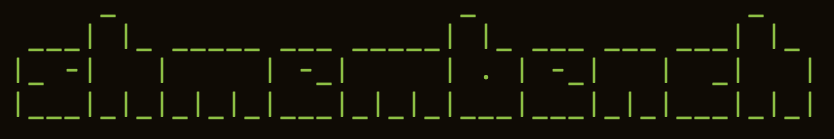

Benchmarking suite for OpenSHMEM 1.4 and 1.5 implementations, with opt-in
OpenSHMEM 1.6 block-strided workloads.

## Building
By default, the Makefile calls `oshcc`. This assumes you have `oshcc` in your PATH, shmem.h in your CPATH/C_INCLUDE_PATH, and OpenSHMEM libraries in your LD_LIBRARY_PATH:
```bash
$ make all USE_SHMEM_VERSION=15 (or 14 for OpenSHMEM 1.4)
```

To specify a custom compiler path:
```bash
$ make all CC=/path/to/oshcc USE_SHMEM_VERSION=15
```

Use `USE_SHMEM_VERSION=16` to enable `shmem_ibput` and `shmem_ibget`.
Use a separate `BUILD_DIR` for each compiler, runtime, or API-version selection;
the Makefile does not detect changes to compiler flags in existing objects.

If a runtime supplies the other 1.5 APIs but lacks `shmem_signal_wait_until`,
build with `DISABLE_SIGNAL_WAIT_UNTIL=1`. This explicitly removes that symbol
dependency and makes its benchmark selection fail with an unsupported diagnostic;
it does not substitute another wait operation or change `USE_SHMEM_VERSION`.
The default is 0 (API enabled). Record this incomplete runtime capability in
comparison results, and use `DISABLE_SIGNAL_WAIT_UNTIL=1` in the environment when
running `scripts/test_workloads.sh` against that build.

All build artifacts are placed in the `build` directory:
- Object files are stored in `build/src/` and related subdirectories
- The executable is placed in `build/bin/shmembench`

To clean all build artifacts:
```bash
$ make clean
```

## Running
```text
Usage:  oshrun -np <num PEs> build/bin/shmembench --bench <routine> --benchtype <type> [options]

Required Options:
  --bench <routine>      Specify the routine to benchmark
                          Available options:
                            shmem_put
                            shmem_putmem
                            shmem_iput
                            shmem_get
                            shmem_getmem
                            shmem_iget
                            shmem_put_nbi
                            shmem_putmem_nbi
                            shmem_get_nbi
                            shmem_getmem_nbi

                            shmem_alltoall
                            shmem_alltoallmem
                            shmem_alltoalls
                            shmem_alltoallsmem
                            shmem_broadcast
                            shmem_broadcastmem
                            shmem_collect
                            shmem_collectmem
                            shmem_fcollect
                            shmem_fcollectmem
                            shmem_barrier_all

                            shmem_atomic_add
                            shmem_atomic_compare_swap
                            shmem_atomic_fetch
                            shmem_atomic_fetch_nbi
                            shmem_atomic_inc
                            shmem_atomic_set
                            shmem_atomic_swap

  --benchtype <type>     Set the benchmark type (bw, bibw, latency)
                           Pt2pt RMA benchmarks support 'bw' (default) and 'bibw'.
                             - Both 'bw' and 'bibw' benchmarks also report latency results.
                           Collectives benchmarks support 'bw' (default).
                             - The 'bw' benchmark also reports latency results.
                           Atomic benchmarks only support 'latency' (default).
                           shmem_barrier_all only supports 'latency' (default).

Optional Parameters:
  --min <size>           Minimum message size in bytes (default: 8)
                            Note: Not applicable for atomic benchmarks.
                            Note: Not applicable for shmem_barrier_all benchmark.

  --max <size>           Maximum message size in bytes (default: 1024)
                            Note: Not applicable for atomic benchmarks.
                            Note: Not applicable for shmem_barrier_all benchmark.

  --ntimes <count>       Number of repetitions.
                         Average among them is reported (default: 10)

  --warmup <count>       Warmup iterations before timing (default: 20).
                         Zero disables warmup; --warmups is an alias.

  --stride <value>       Stride value for strided operations, only used by
                         the shmem_iput and shmem_iget (default: 10)

  --help                 Display this help message

Example Usage:
   oshrun -np 2 shmembench --bench shmem_put --benchtype bw --min 128 --max 1024 --ntimes 20
   oshrun -np 2 shmembench --bench shmem_iget --benchtype bw --min 128 --max 1024 --ntimes 20 --stride 20
   oshrun -np 64 shmembench --bench shmem_broadcast --benchtype bw --min 128 --max 1024 --ntimes 20
   oshrun -np 64 shmembench --bench shmem_barrier_all --benchtype latency --ntimes 100
   oshrun -np 6 shmembench --bench shmem_atomic_add --benchtype latency --ntimes 100
```

The header reports the effective timed iteration and warmup counts. `--ntimes`
must be positive and `--warmup` nonnegative; malformed or overflowing counts
fail rather than silently selecting defaults.

Bandwidth is payload MiB/s (one MiB is 1,048,576 bytes). The bandwidth table's
average time is the timed loop divided by its iteration count, not ping-pong
latency. Completion boundaries differ: `shmem_putmem` bandwidth includes a
fence after each put and one final quiet, whereas `shmem_putmem_nbi` includes
a quiet after each operation. Do not compare these as equivalent windows.

After building, check the measurement controls using an existing launcher
configured for exactly two PEs and a timeout, for example with Open MPI:

```sh
bash scripts/test_measurement_controls.sh build/bin/shmembench \
    oshrun --timeout 30 -np 2
```

## Checked operation workloads

The shared runner provides explicit completion boundaries without changing the
legacy RMA `bw`/`bibw` loops. Select one of these `--benchtype` values:

| Type | Timed region, repeated `--ntimes` times |
| --- | --- |
| `issue` | Issue `--window N` operations; stop timer, then quiet **outside** timing |
| `quiet` | Issue N operations, each followed by quiet **inside** timing |
| `window` | Issue N operations, then one quiet **inside** timing |

N defaults to 1. `--warmup W` runs W complete samples before timing, each
containing N operations with the selected boundary. No fence is inserted.
Every sample is completed before reusing its buffers. Blocking APIs still have
their specified blocking behavior in `issue` mode; in particular, a blocking
fetch is not an initiation-only atomic. For local observations, `issue` measures
the observation calls without quiet, while the other modes deliberately add
quiet overhead. Loop/dispatch/timer overhead is included, not subtracted.

Supported selections:

| API level | `--bench` names for the shared runner |
| --- | --- |
| 1.4+ | `shmem_atomic_add`, `inc`, `set`, `fetch`, `fetch_add`, `swap`, `compare_swap`, `and`, `or`, `xor` (each with the `shmem_atomic_` prefix) |
| 1.4+ | `shmem_putmem`, `shmem_getmem`, `shmem_putmem_nbi`, `shmem_getmem_nbi` |
| 1.4+ | `shmem_p`, `shmem_g`, `shmem_iput`, `shmem_iget`, `shmem_test`, `shmem_wait_until` |
| 1.5+ | `shmem_atomic_fetch_nbi`, `shmem_putmem_signal`, `shmem_putmem_signal_nbi`, `shmem_signal_fetch`, `shmem_signal_wait_until` |
| 1.5+ | `shmem_test_{all,any,some}` and `shmem_wait_until_{all,any,some}`, including each `_vector` variant |
| 1.6 opt-in | `shmem_ibput`, `shmem_ibget` |

Existing atomic `latency` selections now use the shared runner and mean
`quiet`; no reduction collective is needed to print atomic results. New names
default to `quiet`; existing RMA defaults remain `bw`, so specify the new type
explicitly for equivalent comparisons. Typed NBI legacy names are not aliases
for the checked byte-oriented NBI workloads.

All PEs initiate operations. `--target self` selects the initiating PE;
`peer` (default) selects `(PE+1) % npes`; `random` uses a reproducible fixed
32-bit hash schedule for each origin and window slot, including self. The
schedule repeats each sample and is generated outside timing. Peer/random
communication requires at least two PEs. Different origins and window slots
have distinct symmetric destinations: these are **uncontended** atomics, not a
shared-counter contention test. Every target selection is printed. Observation
APIs always operate locally and print `target=local`.

Atomics and scalar APIs use `unsigned long`, ignore message-size bounds, and
report `sizeof(unsigned long)`. Fetch operands start at 7; other operands start
at 0 except AND, which starts at 7. ADD/INC/FETCH_ADD increment by 1; SET/SWAP/OR
use 7, CAS uses compare 0/value 7, AND uses 3, and XOR uses 7. Fetched values
are checked after every sample; final operands are checked on all PEs.
RMA source/destination buffers are separate, initialized, and payloads checked.
Signal puts use `SHMEM_SIGNAL_ADD` with increment 1 and check both delivered
payload and final signal count.

Byte sizes double from `--min` through `--max`. Array and strided workloads
require exact multiples of `sizeof(unsigned long)`. `--block-size B` is the
number of elements per ibput/ibget block; payload element count must be divisible
by B. `--stride S` is the start-to-start element stride for both source and
destination, with S >= B. iput/iget require B=1. Gaps are checked unchanged.
Allocated spans include those gaps and one slot per origin per outstanding
operation; this is intentionally more memory than the transferred payload.

`--ready 0|1` selects not-ready/ready test predicates (default 1). Waits require
1 and therefore measure already-ready observation cost, not notification
latency. `--mask P` excludes the first floor(nelems*P/100) array entries.
All/any/some results, masks, vector predicates, and returned indices are checked
outside timing. Empty all-test sets succeed, empty any-test sets return
`SIZE_MAX`, and empty some-test sets return zero. Wait any/some rejects an empty
eligible set. Different window slots provide distinct fairness signatures,
but this runner does not prove eventual fairness or measure asynchronous
notification rate.

After all checks and a barrier, PE 0 gathers each PE's elapsed time using
`shmem_getmem`, and prints one `RESULT ... check=pass` row per PE per size.
`us` is sample time divided by N, `ops_per_s` is **per-PE** operation rate,
and `MiB_per_s` uses payload bytes, not allocated span. Atomic/observation MiB/s
is only nominal operand volume, not measured wire traffic. No percentiles or
aggregate-throughput claims are made. Require successful process exit, every
expected PE/size row, and positive finite timing fields before using results;
failure after an earlier size can leave partial rows in stdout.

Unknown selections, unsupported compile-time APIs, invalid sizes/counts,
incompatible PE counts, and failed result checks exit nonzero. Runtime-level
unsupported APIs must also fail rather than silently doing nothing. The shared
runner cannot establish correctness of untouched legacy collective benchmarks.

Examples (use the same runtime, PEs, placement, and flags for comparisons):

```sh
oshrun -np 2 build/bin/shmembench --bench shmem_atomic_add \
    --benchtype window --window 32 --target peer --ntimes 1000 --warmup 20
oshrun -np 2 build/bin/shmembench --bench shmem_putmem_nbi \
    --benchtype window --window 32 --min 8 --max 4096 --ntimes 1000
oshrun -np 2 build/bin/shmembench --bench shmem_test_any_vector \
    --benchtype issue --min 64 --max 4096 --mask 50 --ready 0
oshrun -np 2 build/bin/shmembench --bench shmem_ibget \
    --benchtype quiet --min 128 --max 4096 --block-size 4 --stride 8
SHMEM_VERSION=16 bash scripts/test_workloads.sh build/bin/shmembench \
    oshrun --timeout 30 -np 2
```

The bounded regression checks every shared API, all three completion modes on
representative atomic/RMA operations, targets, masking/readiness, and rejection
paths. Run with `SHMEM_VERSION` matching the executable's build selection.
These smoke timings are correctness checks, not benchmark comparisons.

### Specification requirements map

The shared runner follows the pinned
[OpenSHMEM 1.6 source](https://github.com/openshmem-org/specification/tree/46858400cf43d34750c436eb17eb157646a91060):

| Requirement | Normative source under `content/` | Regression |
| --- | --- | --- |
| Initiation versus completed buffers | `shmem_quiet.tex`, `shmem_atomic_fetch_nbi.tex` | issue/quiet/window, fetched-value and payload checks |
| Block-strided element units and source consumption | `shmem_ibput.tex`, `shmem_ibget.tex` | two-element blocks, three-element strides, unchanged gaps |
| Signal denotes delivered payload; NBI completes at quiet | `shmem_put_signal_nbi.tex` | checked payload and accumulated signal value |
| Array mask, readiness and empty-set results | `shmem_test_all.tex`, `shmem_wait_until_all.tex` and corresponding any/some/vector entries | masked ready/not-ready/empty test cases and returned-index checks |

This is workload validation, not full API conformance. Shared-location atomic
contention, delayed notifications, passive-target progress, independent source
and destination strides, explicit contexts, and multi-threaded operation are
not modeled.

## Sample Output
```text

==============================================
===          Test Information              ===
==============================================
  OpenSHMEM Name:         Sandia OpenSHMEM
  OpenSHMEM Version:      1.5

  Number of PEs:          2
  Benchmark:              shmem_put
  Benchmark Type:         bw
  Min Msg Size (bytes):   1
  Max Msg Size (bytes):   1048576
  Ntimes:                 100
  Warmups:                20

==============================================
===          Benchmark Results             ===
==============================================
Message Size     Avg Time (us)    Avg MiB/s
1                21.18            0.36
2                21.20            0.72
4                18.86            1.62
8                18.99            3.21
16               19.01            6.42
32               19.14            12.76
64               21.63            22.57
128              31.48            31.02
256              27.33            71.46
512              28.12            138.91
1024             29.01            269.30
2048             30.27            516.15
4096             32.28            968.04
8192             38.54            1621.68
16384            49.32            2534.51
32768            69.31            3606.95
65536            122.52           4080.94
131072           276.71           3613.88
262144           558.86           3578.71
524288           1040.42          3844.61
1048576          1847.40          4330.41
```

## Contact
Michael Beebe: michael.beebe@ttu.edu
